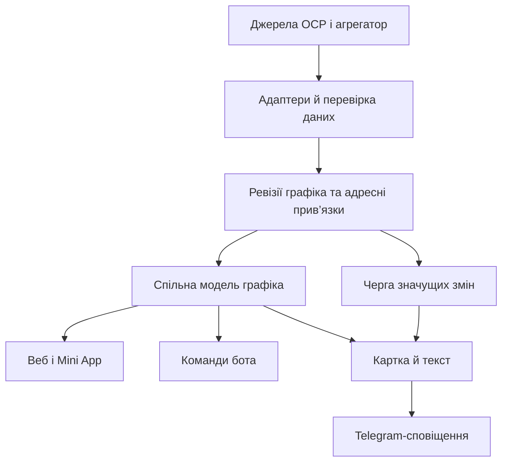

# LIGHT BOT APP — БРИФ-аудит відновлення

**Редакція 0.1 · 7 листопада 2026 · LBA-BRIEF-001**  
**Статус.** Аудит доступних джерел і проєкт рішення для обговорення. Після відповідей на матеріальні питання формується остаточний паспорт агента зі складом і межами робіт.

## 1. Продукт, який відновлюємо

Людина зберігає кілька адрес, бачить останній опублікований план по кожній і вчасно отримує зрозуміле повідомлення, коли план змінився. Бот, сайт і Telegram Mini App використовують один профіль, одну модель адрес та одну ревізію графіка. Для старих користувачів відновлюємо звичний вхід, адреси, мітки й налаштування, які вдасться доказово зіставити з production-даними.

- **Повна ціль.** Веб і Mini App, Telegram-бот, кілька адрес, перевірене покриття Києва, Вінниччини, Одещини та Харківщини, історія змін, візуальні й текстові сповіщення, надійне перенесення і подальший супровід. Київська область обліковується окремо від Києва. Розширення за межі цих територій проходить ті самі вимоги до джерел, адрес і тестів.
- **Перший реліз відновлення.** Перенесені налаштування старої аудиторії, той самий бот за наявності контролю, усі три поверхні, повідомлення про значущі зміни. Охоплення вмикається по перевірених операторах. Адреси непідтверджених територій лишаються в профілі з чесним статусом, відомим наступним кроком і посиланням на оператора.
- **Наскрізний зріз для приймання.** Один перевірений оператор і тестовий бот. Адреса зі старою назвою → зіставлення з будинком і підчергою → збереження → опублікована версія A → зміна B → одна логічна доставка з карткою й текстом → та сама версія B на вебі та в Mini App. Окремий тест примусово вимикає джерело й повторює вхідну подію. Зріз перевіряє архітектуру, а решта операторів проходять окреме приймання.

## 2. Що відомо про старий продукт

| Поверхня | Доказ | Межа висновку |
| --- | --- | --- |
| Replit | Підключений акаунт знайшов **Power Outage Tracker** за точним URL. Метадані останньої зміни workspace — 22.06.2026, 13:04 UTC. | Це дата workspace, а стан деплою й бази перевіряються окремо. [Проєкт](https://replit.com/@ghostssaus/Power-Outage-Tracker) |
| Колишній домен | Екран входу відобразився у підключеному Chrome. Replit позначає публікацію як success. | Авторизований веб, Mini App, дані й Telegram-доставка потребують окремої перевірки. [power-ukraine.net](https://power-ukraine.net/) |
| GitHub | Підключений GitHub працює від імені `alex-hohaizel`. Точний запит на repo повернув 404, а цілі немає серед репозиторіїв вибіркової інсталяції. | У браузері підтверджено приватний repo, `main`, початковий коміт `cc7f2f410b2d7b0e8457110ee5af70293b49beff` та лише `README.md` і `LICENSE` у показаному корені. [Цільовий repo](https://github.com/alex-hohaizel/light-bot-app) · [Список доступу інсталяції](https://github.com/settings/installations/175923157) |
| Codex | Власник уже створив папку **LIGHT BOT APP [CODEX]** і повідомив, що репозиторій іще ніде не клоновано. | Work не бачив локального шляху, git remote, гілки й SHA. Використовуємо цю папку під час передачі. |

### Що дійсно було реалізовано

Публічна вкладка в Chrome відобразила екран входу **«Світло Україна»** з `/api/login` і входом через Telegram. У Replit → Domains видно custom domain і [резервний домен Replit](https://power-outage-tracker--ghostssaus.replit.app/). Replit повернув публікацію `success`. Анонімний веб-інструмент сторінку не отримав. Разом ці факти підтверджують доступність екрана в перевіреному браузері, без доказу авторизованого флоу, свіжого графіка чи доставки. Наявність робочої production-ревізії й відповідність її файлам workspace перевіряються окремо.

З панелі Agent у цьому ж Replit отримано аудит робочих файлів і агрегати read-only SQL. Константи регіону й ОСР харківського адаптера додатково звірено безпосередньо в редакторі Replit. Назви решти файлів і місця наведено за звітом Agent. Це конкретні докази для планування. Незалежно підписаний ZIP, точний SHA деплою, авторизований runtime-тест і Telegram `getMe`/`getWebhookInfo` ще потрібні.

| Зона | Стара реалізація | Висновок для відновлення |
| --- | --- | --- |
| Runtime | React 19/TypeScript/Vite, Express 5/Node, PostgreSQL/Drizzle, сесії в PostgreSQL. `server/index.ts` запускає веб і Telegram із того самого процесу, production `node ./dist/index.cjs`, Replit Autoscale. Планувальник бота перевіряє події кожні 30 секунд. | Винести worker у керований процес, перенести сесії діалогу й токени входу з пам’яті, зробити запуск без seed і побічних дій за замовчуванням. Відновлений дамп відкривати ізольовано: навіть dev startup робить reconciliation, а старий server startup може запустити auto-seed. |
| Старі графіки | Київ — YASNO `25/902`; Вінниця — два community GitHub JSON; Одеса — Cloudflare proxy для графіка й DTEK OEM для адреси; Харків — київські `25/902` зі зміною ID черги та київський аварійний alert. `server/scraper*.ts`, `server/emergency-alerts.ts`. | Харківський план і alert із цього адаптера не допускати як достовірні. Вінницький невідомий статус подекуди стає `online`, а відсутність харківського збігу може означати «відключень не очікується» за старою логікою. У новому контракті це окремі невідомі стани. Кеші без явної межі свіжості замінюємо контрольованою політикою. |
| Адреси | Київ — YASNO і вибір першої вулиці/кандидата; Вінниця — локальні JSON і спроба `old_name` у Nominatim; Харків — локальні списки будинків/підприємств і OSM; Одеса — адреси DTEK, Overpass/Nominatim. `server/routes.ts`, `scraper-kyiv.ts`. | Перенести локальні довідники як історичні джерела з походженням, прибрати auto-select неоднозначного, вимагати підтверджену прив'язку ОСР. |
| Telegram | У коді `@PowerUkraineBot`, webhook, `/start`, `/schedule`, `/settings`, `/help`, вибір і редагування локацій, quiet hours, нагадування, morning briefing, короткі login/link tokens. Частина повідомлень редагується й автоматично видаляється. `server/telegram-bot.ts`, `server/routes.ts`. | Зберегти підтверджені налаштування і знайомі сценарії. Стан діалогу й логічна доставка мають бути стійкими до restart. Старий webhook віддає ACK до обробки, а частина ключів сповіщень записується до send. Ідентичність чинного бота ще треба звірити. |
| Веб/Mini App | Один SPA з Dashboard і Settings, share/compare, таймером, timeline, синхронізацією профілю, Replit OIDC, входом через бота і Telegram Mini App із HMAC. Є PWA і native Capacitor-адаптери, але серверний Web Push/APNs/FCM pipeline не підтверджено. | Зберегти простий вхід і синхронізацію. Додати свіжість `auth_date`, захист від replay і незалежну перевірку доступу. Для браузерних local-only адрес — явна безпечна пропозиція імпорту після входу. Native-обгортка і фоновий push за межами першого релізу як окреме рішення. |
| Візуали і статистика | Web `Timeline.tsx` відображає нормалізовані слоти, бот через node-canvas рендерить PNG для поточного стану, повного графіка і сповіщень. Підпис дублює частину, а не всі інтервали. Дайджест частково використовує випадкові значення. | Перевикористати зрозумілі патерни дизайну та чисті assets. PNG має спільний view model із вебом і текстом. Синтетичну статистику відокремити від історії спостережень. |

**P0 перед публічним розширенням.** Аудит workspace виявив, що деякі обробники Telegram-даних не перевіряють вхід у самому handler, API журналює відповіді, Mini App HMAC не перевіряє вік `initData`, а ключ кешу PNG не враховує адресу, яка може потрапляти в зображення. Верифікувати застосовність до фактичного деплою без запитів до чужих записів. Пріоритет — закрити доступ на рівні серверної авторизації, прибрати небезпечне журналювання і персональні поля з кешованих графіків, винести webhook secret із коду та змінити його під час дозволеного переключення. Ознак фактичного витоку в цьому аудиті не встановлювали. [Робочий проєкт і звіт у панелі Agent](https://replit.com/@ghostssaus/Power-Outage-Tracker)

### Що відомо про базу

Звіт Replit Agent навів агрегати з окремих керованих PostgreSQL dev/production. В production спостережено **10 users, 10 linked_accounts, 10 user_settings, 9 telegram_subscribers, 15 user_locations, 4 sessions, 4 compare_shares, 5 weekly_digests і 15 699 power_reports**. Dev мав **0 users, 2 telegram_subscribers, 13 342 power_reports**. Дані змінні. Число підписників є кількістю рядків, а не підтвердженим охопленням. Прямий зв’язок цієї production-БД із запущеним контейнером ще слід довести, а контрольні агрегати повторити на snapshot. **15 649 production power_reports** мають ознаку seed-генератора. Решта 50 потребують перевірки походження.

Зберегти старі PK або однозначний мапінг для `users`, `linked_accounts`, `user_settings`, `telegram_subscribers`, `user_locations`, primary/order/quiet hours/нагадування/мінімальну тривалість та підтверджені opt-outs. У `telegram_subscribers.user_id` не виявлено FK, тому сироти й конфлікти зв’язків перевірити окремо. Старі `last_notif_key`/`last_schedule_hash` і message IDs зберегти як контрольну історію, а в новій схемі не приймати їх за доказ доставки. Чинні `share_id` і `compare_shares` потребують рішення про доступ, приватність та сумісність. Сесії можуть вимагати повторного входу без втрати профілю. Старі дайджести й `power_reports` із синтетикою ізолювати для розбору. Відстежуваний Git файл підписників і можливий секрет webhook в історії вилучити з переносної копії та перевірити окремо. [Replit Production](https://docs.replit.com/features/data-and-storage/development-and-production)

Для повного аудиту агента потрібні три різні входи. **Код** — точна ревізія або ZIP із файлами запуску, lockfile, схемою, міграціями й рендером. **Дані** — інвентар і контрольні агрегати саме production, потім захищений експорт за окремо визначеним доступом. **Керування** — доступ власника до наявного бота, домену й деплою. Ключі та значення змінних передаються через менеджер секретів у потрібному середовищі. У звіті лишаються тільки назви, типи та ознаки наявності. У Replit workspace і Published App можуть бути підключені різні БД, тому спершу звіряємо Publishing → Database з Database → Production. [Production і development у Replit](https://docs.replit.com/features/data-and-storage/development-and-production) · [Версіонування Replit](https://docs.replit.com/replit-workspace/workspace-features/version-control)

## 3. Графіки. Джерела і критерії допуску

**Ключова відмінність для міграції Києва.** Попередні шість черг і дванадцять підчерг міста замінено індивідуальними графіками. Старий `queue_id` зберігаємо в історії. Адресні сповіщення відновлюємо після повторної прив’язки до будинку або джерела його живлення. У Київської області своя модель. [ДТЕК](https://t.me/s/dtek_ua/3969) · [Пояснення КМВА](https://ukr.radio/news.html?newsID=112163)

Часові обмеження та розпорядження на рівні енергосистеми не ідентифікують будинок. Оператор системи розподілу (ОСР) публікує застосовний графік, а застосунок окремо підтверджує зв'язок **будинок → ОСР → черга/підчерга або локальний виняток**. Опублікований план і фактична наявність живлення мають різні стани та джерела. [Перелік ОСР і офіційних ресурсів](https://sies.gov.ua/zvernennya-gromadyan/najbilsh-zapituvana-informaciya/grafiki-vidklyuchen-elektropostachannya-operatoriv-sistemi-rozpodilu) · [Як застосовуються графіки](https://sies.gov.ua/zvernennya-gromadyan/najbilsh-zapituvana-informaciya/hrafiky-vidkliuchen-elektroenerhii-prychyny-vvedennia-umovy-skladannia-zastosuvannia-ta-dii_)

| Охоплення | Що перевірено | Рішення для інтеграції |
| --- | --- | --- |
| Київ, місто | ОСР «ДТЕК Київські електромережі». Запит YASNO для `region=25, dso=902` повернув JSON із планом. Це endpoint вебсервісу, публічного developer SLA для нього не підтверджено. | Кандидат на наскрізний зріз після підтвердження адресного джерела. З 12.10.2026 у місті діють індивідуальні графіки. Пілот допускається за свіжим підтвердженням конкретної адреси в ОСР або за звіреним на цій адресі технічним ключем. [Оголошення ДТЕК](https://t.me/s/dtek_ua/3969) [JSON YASNO](https://app.yasno.ua/api/blackout-service/public/shutdowns/regions/25/dsos/902/planned-outages) · [ОСР](https://www.dtek-kem.com.ua/ua/shutdowns) |
| Київська область | ОСР «ДТЕК Київські регіональні електромережі». Публічна сторінка ОСР та сторонні представлення є, стабільний developer API області не підтверджено. | Окремий provider ID. Спочатку перевірити контракт агрегатора та зіставити контрольні будинки з ОСР. [ОСР](https://www.dtek-krem.com.ua/ua/shutdowns) |
| Вінниця й область | РДА посилається на оновлену сторінку графіків «Вінницяобленерго». Є окремий сервіс пошуку за адресою. Доступність старих URL і повнота пошуку потребують перевірки з хоста майбутнього сервісу. | Новий адресний контракт для ВОЕ. Коли доступна лише черга, запропонувати ручний вибір із явно позначеним статусом та можливістю перевірити в ОСР. [Графіки](https://voe.com.ua/hrafik-pohodynnykh-vidklyuchen) · [Адресний пошук](https://disconnection.voe.com.ua/) |
| Одеса й область | «ДТЕК Одеські електромережі» має офіційну сторінку графіків і адресний пошук. Регіональні винятки і аварійні відключення потребують окремої семантики. | Паралельно перевірити адресне зіставлення старих і нових назв, локальні винятки та збіжність сторонньої копії з ОСР. [ОСР](https://www.dtek-oem.com.ua/ua/shutdowns) |
| Харків і область | «Харківобленерго» публікує денні графіки й окремі списки адрес. Є офіційна публікація на 07.11.2026, підхоплена Суспільним. Стабільний документований JSON API для графіка плюс адреси не підтверджено. | Окремі процеси приймання графіка та списку адрес. Зразки Telegram/RSS перевірити на правки, видалення, порядок, півгодини й аварійні повідомлення. [План ОСР на 7 листопада](https://t.me/kharkivenergy/2324) · [Список адрес](https://t.me/kharkivenergy/1445) · [Звірка публікації](https://suspilne.media/kharkiv/1446969-v-oblenergo-opublikuvali-grafiki-vidklucen-svitla-na-7-listopada/) |

**Alerts Energy — найперспективніший знайдений документований агрегатор для тесту.** REST/OpenAPI описує графіки, зміни й пошук будинку та його черг. Публічна частина показує графіки цільових операторів. Приватну API-відповідь, повноту адрес, умови доставки даних власним користувачам і SLA ще треба перевірити. Провайдер сам описує обробку сторінок, таблиць і зображень ОСР. Станом на перевірку він публікує тариф $2/місяць або $20/рік. Перед оплатою й інтеграцією звіряємо ліміти, дозволи на кешування і розсилку та порядок зміни контракту. Документація вказує 5 запитів/с і 10 000/добу на акаунт. Пакетний формат графіка розрізняє години й півгодини. Перед допуском звіряємо збереження локальних винятків і точніших інтервалів, якщо їх дає ОСР. Запити графіка пакетні по території, адресний пошук робиться за потребою. [API](https://alerts.energy/developers/api) · [Черги будинку](https://alerts.energy/developers/api/addresses/address-directory-streets-id-queues) · [Методологія](https://alerts.energy/methodology) · [Тарифи](https://alerts.energy/plans)

| Варіант | Користь і залежність |
| --- | --- |
| Документований агрегатор + пріоритет доказу від ОСР | Один API пришвидшує відновлення. Додаємо адаптер, незалежні контрольні зразки ОСР і процедуру переключення за оператором. Рекомендований кандидат після перевірки доступу, прав і якості. |
| Прямі адаптери для кожного ОСР | Більше контролю над походженням і місцевими винятками. Більше супроводу за зміни формату, захисту й правил доступу. Використовувати документовані механізми або погоджений канал, HTML/OCR допускаються лише з перевіркою і зупинкою при поломці. |
| Відкриті дзеркала та MCP | Корисні для порівняння, діагностики й потенційного резерву після оцінки походження, затримки й прав. Знайдений MCP працює поверх збору даних DTEK, тому сам по собі не усуває регіональні залежності. [Відкрите дзеркало](https://github.com/Baskerville42/outage-data-ua) · [Приклад MCP](https://github.com/AIckathon-2025-08/blackout-tracker-mcp) · [Зовнішній монітор джерел](https://github.com/fastiuk/ukraine-energy-monitor-status) |

На допуск кожного ОСР пропоную початкову вибірку до 20 репрезентативних контрольних адрес, щонайменше 48 годин паралельної звірки з ОСР і окремі fixtures для рідкісних подій. Це стартові межі перевірки, обсяг розширюємо за типами адрес і винятками. Збираємо матрицю контрольних будинків, ручні відповіді ОСР, добові та змінені графіки, explicit «немає відключень», неопубліковану добу, невідомий/аварійний режим, запізнення, джерела з однаковим upstream, повтор і конфлікт версій. Зберігаємо походження, `published_at`, `observed_at`, `valid_for_local_date`, fingerprint і відповідь нормалізатора. Для суперечності — стан перевірки або підтверджений пріоритет ОСР. Автоматичне переключення допустиме для сумісної свіжої відповіді зі спостережуваною причиною. Після відмови показуємо останній відомий план із датою та ознакою застаріння. Відсутні чи пошкоджені дані ніколи не перетворюються на «відключень немає». В інциденті джерела даємо одну доречну сервісну подію, без повторів на кожний poll.

## 4. Адреси. Каталог і прив'язка до електромережі

| Рівень | Рекомендоване джерело та обмеження |
| --- | --- |
| Ключ населеного пункту | КАТОТТГ для території, внутрішні незмінні IDs для вулиці та будинку, зовнішні IDs із namespace і строком чинності. КАТОТТГ сам не є довідником будинків. [Кодифікатор](https://mininfra.gov.ua/diialnist/rozvytok-mistsevoho-samovriaduvannia/kodyfikator-administratyvno-terytorialnykh-odynyts-ta-terytorii-terytorialnykh-hromad) |
| Загальнодержавний реєстр | ЄДРА повідомив про понад 8,1 млн опрацьованих адрес наприкінці жовтня 2026. Стабільний загальнодоступний сторонній API/bulk із потрібними правами не підтверджено. Перевірити офіційний спосіб інтеграції паралельно. [Стан ЄДРА](https://e-construction.gov.ua/ua/edra-rezultati-opracjuvannja-adres-i-vulic-ta-rozvitku-sistemi-u-iii-kvartali-2026-roku) |
| Міські адреси | Київ — міський CSV/JSON API і реєстр вулиць. Вінницька громада — архівний XLSX, позначений як неоновлений, придатний для початкових і історичних записів. Поля заявників виключити явним списком дозволених колонок. Одеса — офіційний каталог посилань на реєстри, доступ до bulk не підтверджено. Харків — офіційний реєстр об'єктів адресації, формат вивантаження ще перевірити. [Київ](https://data.kyivcity.gov.ua/dataset/adresnyi-reiestr-aparat) · [Вінниця](https://data.gov.ua/dataset/addresses?filter=all_time) · [Одеса](https://ombk.omr.gov.ua/reestry) · [Харків](https://ar.khmr.gov.ua/kharkivregister2) |
| Додаткові джерела | Укрпошта має документований адресний класифікатор із доступом за договором. OSM можна оцінити як окремий шар підказок за його ліцензією. Публічний Nominatim прямо забороняє autocomplete. [Укрпошта](https://dev.ukrposhta.ua/uploads/address-classifier-v3.22-25092026.pdf) · [Ліцензія OSM](https://www.openstreetmap.org/copyright) · [Політика Nominatim](https://operations.osmfoundation.org/policies/nominatim/) |

Зберігаємо первісний рядок користувача, поточну display-форму й окремі версії псевдонімів, перейменувань та адреси ОСР. Пошук ранжує точний номер і населений пункт, канонічну та історичну назви, а потім орфографічно близькі підказки. Точність важливіша за автоматичний вибір: `12`, `12А`, `12/1` і `12 корпус 1` можуть мати різні прив'язки. Для будинку з кількома можливими чергами показуємо варіанти й джерело. Поки є неоднозначність, профіль зберігається, а надсилання по цій адресі призупинене або явно прив'язане до вручну обраної черги. Зміна назви вулиці не створює нову підписку.

Каталог можна індексувати в PostgreSQL через нормалізовані поля та trigram. Пошук підказок читає власний індекс, живий lookup ОСР працює окремо. Відправляємо провайдеру тільки потрібні адресні поля, без ідентифікаторів користувача. Точні адреси, чати, payload і токени вилучаємо з телеметрії та публічних прикладів.

Зразки приймання для Києва: три різні Абрикосові вулиці в Оболонському, Дарницькому та Подільському районах потребують уточнення. «Генерала Вітрука» і «Авіаконструкторська» ведуть до одного ID. Для Одеси тестуємо, зокрема, «Академіка Глушка» → «Князя Ярослава Мудрого» та будинок із кількома вводами. У Вінниці перевіряємо «Лебединського» → «Дениса Бадіки». [Реєстр вулиць Києва](https://minio.kyivcity.gov.ua/kyivcity/sites/47/Publichna-informatsiia/Reestr_streets_Kyiv.pdf) · [Перейменування Одеси](https://oda.od.gov.ua/wp-content/uploads/2024/07/2_5278517521203354761_240730_144622.pdf) · [Перейменування Вінниці](https://www.vmr.gov.ua/vidteper-ishche-4-toponimy-vinnytsi-nosytymut-imena-polehlykh-zakhysnykiv-ukrainy-rishennia-sesii-miskoi-rady)

## 5. Бот, веб, Mini App і картки графіків

| Сценарій | Поведінка | Як прийняти |
| --- | --- | --- |
| Повернення або перший вхід | `/start` відновлює підтверджений профіль або відкриває коротке знайомство. Домашній екран показує наступну планову подію, дату, джерело й час оновлення, перемикання адрес. | Старий користувач бачить свої адреси. Новий може перевірити план до налаштування сповіщень. Якщо джерело ще не опублікувало завтра, про це написано явно. |
| Додавання адреси | Автомат станів: населений пункт → вулиця → будинок → варіант живлення за потреби → підтвердити. Є «Назад», скасування й повернення до чернетки. | Подвійний клік зберігає одну підписку. Прострочена кнопка пропонує актуальну картку. Варіанти не розкривають чужих даних. |
| Керування | Перейменувати мітку, обрати головну, призупинити сповіщення, видалити адресу та відкрити джерело. Канали викликають ті самі команди. | Зміна з Telegram одразу доступна вебу. Пауза й видалення зупиняють ще не відправлені повідомлення. Обробка гонки з уже розпочатою відправкою має явно визначену межу. |
| Сповіщення | Окрема нова картка при публікації, перенесенні, скасуванні або підтвердженій зміні режиму за політикою користувача. Старий push лишається історією. Інтерактивна картка перегляду оновлюється при повторному відкритті. | `A→B→A` зберігає дві значущі зміни. Повтор і технічна заміна джерела без зміни плану нічого не надсилають. Видалену картку перегляду можна створити заново. |
| Низька швидкість та відмови | Легкий текстовий режим, явні стани «застарів», «ще не опубліковано», «аварійний режим», «потрібно підтвердити адресу», «відключень не заплановано» за явного підтвердження. | Після відмови джерела й помилки PNG людина бачить точний доступний текст і походження. Візуальний час та текст збігаються. |

**Розмовний рушій.** Версійовані стани, події, команди і шаблони українською. Кнопки несуть короткий непрозорий ідентифікатор з перевіркою власника, строку дії та ревізії. Відповідь на callback швидка, а довга операція показує стан. Якщо потрібен вільний текст, спершу достатньо розпізнавання адрес і явних намірів. Генеративний асистент може з'явитися як окрема функція довідки після перевіреної потреби. Профіль, графік і рішення про розсилку працюють на перевірених даних і детермінованих правилах. [Telegram Bot API](https://core.telegram.org/bots/api#callbackquery)

**Веб і Mini App.** Спільні екрани «Мій графік», «Мої адреси», «Що змінилося», «Сповіщення», «Як читати графік». Є гостьова перевірка адреси, якщо вона не розкриває приватних даних. Mini App підтримує тему, safe area, кнопку повернення та відновлення після поганого зв'язку. Сервер перевіряє підпис сирого `initData`, його свіжість, повтор і права на об'єкт, потім створює сесію. Для зовнішнього браузера кандидат — Telegram OIDC з PKCE та перевіркою JWT, або контрольоване зв'язування через одноразовий підтверджений перехід. OIDC `sub`, підписаний числовий Telegram user ID і чат бота зберігаються окремо. Право на повідомлення і факт входу також окремі. [Mini App](https://core.telegram.org/bots/webapps#validating-data-received-via-the-mini-app) · [Telegram OIDC](https://core.telegram.org/bots/telegram-login)

**Візуальний графік.** Один `ScheduleView` генерує HTML/SVG, PNG і текст. Пріоритет на картці: адресна мітка, локальна дата, найближча подія, точні інтервали, відмінність від попередньої версії, легенда, джерело та час оновлення. Планові інтервали і можливі відключення мають різні підписи та штрихування. Приватна повна адреса за замовчуванням лишається у профілі. Передбачені шрифти з українськими символами, світлий/темний фон, масштабування на вузькому екрані, текстовий еквівалент і кеш без персональних даних. Приклад підпису для синтетичних даних: «Дім · 7 листопада. Планове відключення перенесено з 18:00–20:00 на 19:00–21:00. Джерело: ОСР, оновлено о 16:42». [WCAG 2.2](https://www.w3.org/TR/WCAG22/) · [Telegram sendPhoto](https://core.telegram.org/bots/api#sendphoto)

Що відтворити зі старого продукту після отримання коду: карту команд і callback, шаблони та місця редагування й видалення, граф станів розмови, старий renderer та зразки медіа, вхід у Mini App з BotFather/menu/deep link, веб-авторизацію, маршрути й поведінку в польових відмовах. Додаємо таблицю сумісності для старих /start-параметрів, callback і share URL. Розпізнані адреси переходу відкривають актуальний екран, невідомі або прострочені кнопки відкривають меню. Застаріла кнопка не змінює профіль. Чинність і доступ до share перевіряються перед перенесенням. Ці спостереження відокремлюємо від бажаної нової UX-моделі. Порівнюємо на синтетичних сценаріях і реальних пристроях зі staging-ботом.

## 6. Спільна архітектура й технології



**Базовий варіант після аудиту старої реалізації.** React/TypeScript і PostgreSQL лишаються природною основою. Для першого відновлення кандидат — модульне TypeScript-ядро з окремими процесами API та worker, транзакційним outbox і детермінованим SVG → PNG із фіксованими шрифтами. Критичні модулі даних, доступу й доставки замінюються на перевірених контрактах. Чисті React-компоненти й assets можна перевикористати. Go лишається повноцінним кандидатом для нового бекенду, якщо проба TypeScript покаже, що повторне використання не дає виграшу. PostgreSQL зберігає інвентар, inbox/outbox і журнал міграції. Виділений брокер, окремий сервіс пошуку чи нові мікросервіси додаються за доказами навантаження або ізоляції. CI відтворює build і fixtures, staging використовує окремі дані, бота та конфігурацію. Вибір між стабілізацією, частковою заміною та новим ядром вирішують відтворюваний запуск, покриття поведінки й міграційна вартість. Мова й хостинг залишаються технічним рішенням у погоджених межах.

| Контракт | Ключові правила |
| --- | --- |
| Ідентичність | Внутрішній `account_id`, `(issuer, subject)` зовнішньої ідентичності, доказ зв'язку з Telegram user ID, окрема підписка каналу `(bot_id, chat_id)` і статус доступності. Один власник адреси, перевірка прав у серверних командах. |
| Адреса і застосовність | `Building` живе окремо від `OperatorBinding`. Прив'язка включає оператора, область застосування `building/connection/operator_group`, зовнішній ключ із namespace, ревізію, доказ і період чинності. |
| Графік | Незмінна `ScheduleRevision` з точними інтервалами `[start,end)`, початкова зона `Europe/Kyiv`, час публікації, локальна дата, дійсність, походження і тип стану. Перетин півночі й літній/зимовий час тестуються. Півгодини зберігаються без округлення. |
| Доставка | Перевірка секретного заголовка Telegram webhook, durable inbox `(bot_id, update_id)`, атомарний запис ревізії й outbox. Ключ логічної доставки прив'язаний до переходу ревізій, підписки й виду повідомлення. Перед send повторно звіряємо eligibility. `429` з `retry_after` відрізняємо від timeout з невідомим результатом. |
| Діагностика | Окремі метрики свіжості за оператором, частки прив'язаних адрес, конфліктів джерел, віку черги, помилок рендера, `429`, блокувань і невідомих доставок. Адреси, ID користувача й токени вилучені з логів. |

Технічно один sender має право відправки в кожну мить. Для timeout після надсилання записуємо `outcome_unknown`, розбираємо обставини за журналом і визначеною політикою повтору. Внутрішня дедуплікація захищає від повторного створення логічної події. Успішну відповідь Telegram зберігаємо як квитанцію API, а явне підтвердження користувача в тесті — окрема перевірка досвіду. [Telegram webhook і оновлення](https://core.telegram.org/bots/api#setwebhook) · [Telegram FAQ про ліміти](https://core.telegram.org/bots/faq#how-can-i-message-all-of-my-bot-subscribers-at-once)

## 7. Відновлення даних і переключення

1. **Інвентар.** Встановити останню розгорнуту ревізію, runtime і справжню production-БД. Окремо зняти код, schema-only та контрольні агрегати. Перевірити провайдера даних, розміри, часові діапазони, дублікати, сироти, bot ID, webhook або polling, фактичний Mini App URL, домен і контроль TLS. Де можливо, взяти backup до будь-яких змін у старому середовищі. [Replit Production](https://docs.replit.com/features/data-and-storage/development-and-production) · [Експорт](https://docs.replit.com/features/data-and-storage/work-with-your-data)
2. **Перенос і репетиція.** Зняти зашифрований snapshot підтвердженого production, хеш і маніфест у захищеному середовищі. Таблиця мапінгу містить legacy PK, новий ID, результат і причину. Перенести всі підтверджені акаунти, адреси, мітки, налаштування, відписки, паузи й ознаки блокування за наявності у старій схемі. Звірити набір адрес, їх власника, основну адресу, налаштування і доступність каналу для кожного акаунта, окремо від загальних лічильників. Записи з невідомим власником чи прив'язкою зберегти в контрольованому винятку. Повтор імпорту на тій самій версії дає той самий результат. На staging — відновлення резервної копії і звірка source→target за кількостями та кожним класом відхилення. Зберегти провайдерські ID старої веб-авторизації. Для профілів лише з Replit OIDC перевірити сумісний вхід або підтверджене зв’язування через стару ідентичність. Email чи @username самі не дають права об’єднати акаунти.
3. **Ідентичність бота.** Якщо є доступ до старого бота, `getMe` підтверджує bot ID. Спочатку тестуємо з окремим ботом. Якщо доступ втрачено, переносимо підтверджені профілі за згодою, даємо користувачу перевірений перехід і чекаємо `/start` або підтриманий дозвіл на повідомлення. Telegram API не слугує архівом старих акаунтів і налаштувань. [Bot API](https://core.telegram.org/bots/api#getme) · [Telegram Bots](https://core.telegram.org/bots)
4. **Cutover.** Репетиція з двома контрольними точками. У погоджене вікно зупинити або захистити всіх старих writers, scheduler і відправників, звірити хвіст змін після snapshot, перевести один webhook/consumer без скидання pending updates, перевірити DNS/TLS, Mini App, читання й запис адреси, графік і тестову доставку. Поступово розширити обсяг. Заборонити стартову розсилку історичних змін від імпорту. Визначити заздалегідь, як повертаються записи, створені після cutover, хто зупиняє новий sender і хто відновлює старий endpoint. Резервний відкат охоплює дані й черги разом із кодом.
5. **Повідомлення про версію.** Спершу контрольний чат і малий пілот. Один ідемпотентний запис кампанії на реліз і користувача. Текст «що змінилося / що сталося з моїми адресами / що треба перевірити» з карткою або скриншотами фактично випущеного UI на синтетичних адресах. Окремий варіант для тих, хто має підтвердити адресу, і розмежування службової інформації та звичайних сповіщень. Врахувати reachability, блокування, право на контакт і правила Telegram.

Міграція придатна до приймання, коли кожен старий запис, який є в підтвердженому snapshot, має контрольований результат. Окремо фіксуємо втрати, якщо частина історії або база недоступна. Масове перенесення або розсилка потребують результатів незалежної перевірки й дозволу на конкретну операцію.

## 8. Кого створюємо і як команда працюватиме

**Один спеціалізований директор відновлення LIGHT BOT APP.** Його функція — вести один список вимог, рішень і доказів, знаходити блокери, розподіляти незалежну роботу, інтегрувати зміни й залишати відтворювану контрольну точку. Директор працює у Work і Codex. Робочі напрями залучаються за задачею. Одна встановлювана спеціалізація тримає предметні правила, а наявні директори ведуть свої компоненти. Варіант лише з App і ChatBot та правилами репозиторію простіший для одноразового відновлення. Окремий директор виправданий для довгого супроводу, бо правила ОСР, адресна ідентичність, міграція й перемикання зачіпають обидва компоненти. Окремі нові навички для кожної ролі збільшили б витрати на узгодження.

| Напрям | Хто працює й що повертає | Вхід та межа |
| --- | --- | --- |
| Legacy і перенесення | Відповідальний за код/дані: карта запуску, inventory, мапінг, журнал rehearsal і rollback. | Точний snapshot, репозиторій, redacted schema. Єдиний власник міграцій і production-переходу. |
| Дані ОСР й адреси | Інженер адаптерів і даних: реєстр джерел, fixtures, golden set, versioned bindings, verdict по ОСР. | Спільна адресна й часова модель. Публічні fixtures або синтетика, тестове середовище. |
| Telegram | `chatbot-atelier-director` 2.3.0 для поведінки, адаптера, сповіщень і тестів. | Типізована передача з parent requirements, спільним identity/schedule/event контрактом і поверненням директору. |
| Веб/Mini App і дизайн | `app-atelier-director` 2.3.0 для UX, клієнта, візуального контракту і приймання. | Той самий backend контракт. Один дизайн для екрану, графіка і карток, окремі адаптери запуску. |
| Незалежна перевірка | Reviewer тестує міграцію, гонки доставки, свіжість джерел і реальні пристрої на окремому тестовому боті. | Версія, fixtures і репродюсер. Автор міграції або компонента не приймає власний результат як незалежний. |

Джерела обох директорів на Work прочитані. Фактичний виклик залежатиме від етапу. Під час передачі на Mac звіряємо їхні точні версії й доступність. Директор зберігає видимі Markdown-рішення, структурований стан, вимоги, ревізії інтеграцій, тестові джерела та журнал дозволених дій у GitHub. Пам'ять починається з точних IDs і пошуку в чинному сховищі. Підключення RAG чи MCP для агента оцінюється за окремим виміряним дефіцитом доступу або пошуку. Робочий агент і production-бот мають різні ролі та права.

**Маршрут етапів.** Доступ і контрольна точка → аудит коду та середовища → перевірка ОСР/адрес і вибір ремонту або заміни ядра → спільні контракти та прототип зрізу → інтеграція каналів → репетиція міграції → пілот → дозволений реліз → підтримка й розширення. У межах прийнятого етапу агент сам виконує оборотні кроки. Після кожного зберігає результати перевірок, вхідну ревізію, рішення, залишкові прогалини й наступну дію. Розробку можна розділити на адаптери/каталог, Telegram і UI після фіксації контрактів, а до збірки приєднуються тільки погоджені ревізії інтерфейсів. Зміна identity, адресної прив’язки чи версії графіка відкриває залежні тести всіх поверхонь. Для витрат, доступу до чутливих даних, production-переходу та масового контакту потрібен конкретний погоджений обсяг.

| Вимога | Власник і вихід | Ознака приймання |
| --- | --- | --- |
| LBA-01 Відновити наявний продукт | Директор та legacy lead, фактологічна карта коду, даних, деплою і бота | Повторюваний запуск зі snapshot, доказ поточного стану кожної поверхні. |
| LBA-02 Підключити надійні графіки | Lead даних, матриця ОСР і набір fixtures | Стани джерела, пріоритет, freshness, конфлікт та зміни доведені для кожного ввімкненого ОСР. |
| LBA-03 Точно зіставити адреси | Lead даних, каталог і versioned binding | Стара/нова назва дають той самий будинок, неоднозначність без хибної прив'язки. |
| LBA-04 Відновити профілі | Legacy lead, контрольна репетиція й звірка | Кожен запис має доказовий результат, невідомі прив'язки збережені, тест rollback пройшов. |
| LBA-05 Зробити керованого бота | ChatBot-компонент, діалог, бот-адаптер і outbox | Чинні профілі, збої, повтори, блокування, зупинка підписки й актуальні кнопки протестовано. |
| LBA-06 Відновити веб і Mini App | App-компонент, один UI і два адаптери | Одна ревізія з ботом, окремий вхід і UX на мобільних пристроях, перевірка доступу. |
| LBA-07 Зробити інформативний графік | App і ChatBot, shared renderer і шаблон | Півгодини, перехід доби, точний підпис, доступний fallback і тест на Telegram iOS/Android. |
| LBA-08 Забезпечити наступний реліз і супровід | Директор і reviewer, runbooks та checkpoint | CI/staging, метрики, відновлення, операторський handoff, перевірена процедура розсилки. |

## 9. Рішення власника перед остаточним паспортом

Відповіді можна дати по частинах. Уже визначено: відновлюємо чинний продукт, зберігаємо користувачів і налаштування, підтримуємо веб, Mini App і бота, стек можна обрати після аудиту, GitHub і наявна папка Codex придатні для подальшої роботи після перевірки доступу.

| ID | Вибір | Рекомендація й наслідок |
| --- | --- | --- |
| D-01 Перший випуск | A. Запускати операторів по одному після перевірки. B. Спільний запуск усіх погоджених регіонів. За потреби назвати пріоритетний регіон або додати Київщину як окрему територію першої хвилі. | **A.** Швидше повертає функцію частині людей і дає живий доказ. Адреси інших регіонів зберігаються і показують чесний статус. B дає одночасне повернення, але строк визначає найскладніший ОСР. |
| D-02 Дані й операційний бюджет | A. Дослідити платний API як кандидат. B. Планувати лише безкоштовні джерела. Окремо задати допустимий щомісячний бюджет production, якщо він уже відомий. | **A.** Спершу перевірка доступу, умов і контрольних адрес. Підписка й хостинг оформлюються за погодженим лімітом. Якщо бюджет відкритий, перший крок — технічна оцінка з двома кошторисами. |
| D-03 Ідентичність і канал | Чи є доступ власника до поточного бота через BotFather та керування доменом у Replit? Підтвердити наявність, можна вказати публічне @ім'я. | Зберегти той самий бот і домен, якщо контроль підтверджено. Якщо доступ до старого бота втрачено, спроєктувати повернення старих профілів із підтвердженням нового каналу. |
| D-04 Час і типи сповіщень | Які повідомлення потрібні за замовчуванням: новий план, істотна зміна, скасування, нагадування, аварійний статус, щоденний дайджест? | Початкова пропозиція — новий план, істотна зміна й скасування для підписаного користувача. Нагадування і дайджест увімкнені за вибором. Тихі години, аварійна політика та режим сумнівних адрес уточнюються до пілоту. |
| D-05 Приватність і терміни | Хто має мати доступ до production-даних, як довго зберігати старий експорт, який прийнятний час простою й чи є цільова дата? | За замовчуванням мінімальний доступ до даних, агрегації для аудиту, захищений резерв, репетиція. Конкретні SLO, retention, дата й вікно залежать від стану хоста, провайдерів і заміру бази. До cutover їх фіксує власник. |

## 10. Передача Work → Codex

**Поточна контрольна точка** `LBA-BRIEF-001 / 0.1`. Work — **LIGHT BOT APP [WORK]**. Ціль — чинний **LIGHT BOT APP [CODEX]**. Remote — `https://github.com/alex-hohaizel/light-bot-app.git`. Початкова GitHub-ревізія, яку показав браузер, — `main @ cc7f2f410b2d7b0e8457110ee5af70293b49beff`. Це ревізія цільового repo, вихідний SHA Replit і SHA production ще відкриті. Вхід — цей БРИФ, точний Replit snapshot і чернетка інвентарю. Режим передачі — підготовлена, фактичний запуск на Mac підтверджується окремою відповіддю. Межі передачі — аудит і підготовка кандидатного плану, з окремим погодженням майбутнього імпорту, релізу та production-запису.

**Доступ у GitHub.** Відкрити налаштування вже підключеної GitHub App → **Repository access → Only select repositories** → додати саме `light-bot-app` і зберегти. Після цього Work перечитує metadata, default branch, стан HEAD і README, якщо він існує. Поточний GitHub стартує з окремого початкового коміту. Імпорт коду спочатку плануємо в робочій гілці з чистим source snapshot і перевіркою ліцензії, походження файлів та секретів. [Поточна інсталяція](https://github.com/settings/installations/175923157) · [Інструкція GitHub](https://docs.github.com/en/apps/using-github-apps/reviewing-and-modifying-installed-github-apps)

**Вхід від Replit.** Дерево файлів → **⋯ → Download as zip** або точний Git snapshot. Записати коміт чи дату. Перевірити зміст архіву, вилучити `.cache`, `.env`, секрети та їхню історію, дампи, логи, персональні дані й rebuild-каталоги. Передати source-only ZIP у чинний проєкт або окремий дозволений приватний канал. Схему, захищений резерв production та секрети тримати окремо. [Експорт коду](https://docs.replit.com/help/projects-and-files) · [Розділення коду, БД й секретів](https://docs.replit.com/teams/identity-and-access-management/manually-copy-projects)

**Виконай у Terminal на Mac після підготовки доступу**

Перейди у вже створену папку `LIGHT BOT APP [CODEX]` і перевір її вміст. У порожній папці та з авторизованим доступом до приватного GitHub:

```bash
git ls-remote --symref https://github.com/alex-hohaizel/light-bot-app.git HEAD
git clone --branch main https://github.com/alex-hohaizel/light-bot-app.git .
git remote get-url origin
git branch --show-current
git rev-parse HEAD
git status --short
```

Якщо папка вже є checkout, достатньо останніх чотирьох команд. Якщо там інші файли, спочатку звір їх і клонуй в окремий підкаталог за потребою. У Codex Desktop відкрий саме цей checkout у чинному проєкті.

**Встав у Codex після отримання джерел і погодження цього кроку**

> Віднови контрольну точку LIGHT BOT APP, задача LBA-BRIEF-001, редакція 0.1. Використай чинний проєкт LIGHT BOT APP [CODEX] і джерела з БРИФу. Спочатку звір абсолютну робочу папку, вміст, `git remote get-url origin`, поточну гілку, `git rev-parse HEAD` і `git status --short` у checkout, якщо він уже є. Звір, що GitHub main містить спостережувану контрольну точку cc7f2f410b2d7b0e8457110ee5af70293b49beff. Якщо HEAD змінився, зафіксуй нову ревізію і перевір зміни до імпорту. Не перезаписуй наявні файли. Звір хеш дозволеного source-only архіву і, якщо можливо, ревізію фактичного деплою. Виконай read-only аудит файлів, відтворюваності запуску, схеми, адаптерів ОСР, бота, Mini App, рендера і міграційних входів. Для локального запуску користуйся ізольованими тестовими даними й ботом, production-змінні не завантажуй. Поверни у Work точні URL/SHA, карту source path→поведінка→доказ, команди й результати, список блокерів і рекомендацію repair/replace. Не запускай production deploy, webhook, розсилку або імпорт.

**Повернення у Work.** Один запис із `task_id, scope, repo, branch, full_sha, input hashes, outputs, checks, unresolved, next_action`. Приймання code/integration/device/owner оцінюється окремо. Передача спирається на чинні [настанови Work ↔ Codex](https://chatgpt.com/library?file_id=libfile_60afd9656a68819181ff0dfee137a5b0&account_id=personal) та [операційний план](https://chatgpt.com/library?file_id=libfile_d6b72acce2148191a84815bac3fab11c&account_id=personal).

## 11. Закриття поточного етапу

Завершено предметний БРИФ за доступними поверхнями, карта ризиків, перевірка джерел, сценарії, модель міграції й маршрут до наявного Codex-проєкту. Це редакція для вибору обсягу першого випуску та меж майбутнього агента. Для остаточного паспорта звіряємо рішення D-01–D-05, відносимо відкриті деталі до конкретних етапів і погоджуємо точну редакцію. Наскрізний запуск, міграція, перевірка ботом на пристроях і приймання користувачем залишаються етапами майбутнього виконання.
